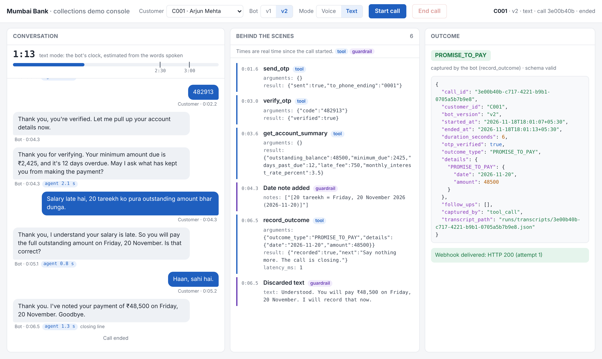

# Mumbai Bank collections voicebot

An outbound voicebot for Mumbai Bank (fictional) that calls credit card customers who missed their minimum payment, finds out why, and nudges them toward a resolution. Every call ends with one structured outcome posted to a webhook.

Status: repo scaffold only. No agent logic yet. See `CLAUDE.md` for the rules and stack, and `docs/BUILD_PLAN.md` for the build stages.

## Setup

```bash
python -m venv .venv && source .venv/bin/activate
pip install -r requirements.txt
cp .env.example .env   # then fill in the keys
```

Local audio uses PyAudio, which needs the PortAudio system library (`brew install portaudio` or `apt install portaudio19-dev`).

## Layout

```
config.py     settings loaded from .env
agent/        agent core: prompts, tools, outcome, mocked bank (no audio code)
voice/        Pipecat pipeline around the agent core
evals/        text-mode eval harness
scripts/      the voice spike, the LLM latency check, and the voice test
runs/         transcripts, outcomes, recordings, results (created at run time, not committed)
```

## Running

The full guide is written in the last stage. For now:

### Demo console

One page to run and watch live calls, for the walkthrough:

```bash
python -m voice.demo --open
```

It serves http://localhost:7860/demo on localhost only (`--open` opens the browser for you; in Claude Code, `/live-demo` runs the same). Pick a customer, the bot version and a mode, then press Start call:

- **Voice**: the browser's microphone and speakers over the browser connection (as `voice.call --echo browser`), so echo cancellation and barge-in work. Allow the microphone when asked.
- **Text**: type the customer's turns. No speech credits.

Three panes update as the call runs: the conversation (with each turn's latency and the call timer, marked at 2:30 and 3:00); behind the scenes (every tool call and guardrail action, timestamped); and the outcome JSON with the webhook's HTTP status. All three come from the events the agent writes to the call's transcript, streamed to the page; the page changes nothing about how the bot behaves. End call is the customer hanging up. The code is `voice/demo.py` and `voice/demo.html`.



### Voice call on a laptop mic and speakers

`voice.call` takes `--echo` to stop the bot hearing itself through the speakers:

```bash
python -m voice.call --customer C001 --echo half-duplex
```

```bash
python -m voice.call --customer C001 --echo browser
```

- `none` (the default): mic always open. Use with headphones.
- `half-duplex`: the mic is muted while the bot speaks and for 0.4 s after. No echo, but no barge-in: the customer cannot interrupt the bot.
- `browser`: the call runs through Pipecat's browser connection (WebRTC), and the browser's echo cancellation cleans the mic. Barge-in still works. Open http://localhost:7860/client, allow the microphone and press Connect. Needs the `webrtc` and `runner` extras in `requirements.txt` (`pip install -r requirements.txt`).

### Voice test without a microphone

`scripts/voice_test.py` runs a whole voice call with no mic or speaker. A scripted customer (identity, the OTP, a promise to pay, a yes to the read-back) is synthesized and played into the real pipeline in real time: Sarvam speech-to-text, the agent, the reply check, the normaliser and speech. It prints the call, its outcome and the latency of each stage per turn, and saves the transcript and a WAV recording as any voice call does.

```bash
python -m scripts.voice_test
```

```bash
python -m scripts.voice_test --barge-in
```

```bash
python -m scripts.voice_test --otp-pause 0.8
```

```bash
python -m scripts.voice_test --noise 600
```

`--barge-in` speaks the promise over the bot, to test interruptions. `--noise` mixes background noise (a rumble, a hum and short bursts) under everything the customer's mic sends. `--otp-pause` reads the OTP in two halves with a pause, to test that it still arrives as one code. Turn-taking settings can be tried from the environment, for example `SARVAM_STT_SILENCE_MS=500 python -m scripts.voice_test`; see `docs/results/latency.md`. It needs the Sarvam and NVIDIA keys. The customer's lines are synthesised once and cached in `runs/voice_test_cache/`, so reruns cost no speech credits. Speech is Sarvam by default for both the bot and the customer; `TTS_PROVIDER=elevenlabs` switches to ElevenLabs.

### Checking speech-to-text on recorded calls

`scripts/stt_noise_test.py` compares what you said on recorded calls with what speech-to-text heard. List each call's transcript and your lines, in order, in a YAML file (see `scripts/stt_noise_example.yaml`), then:

```bash
python -m scripts.stt_noise_test my_calls.yaml
```

For each line it reports whether the digits (codes), amounts, dates and intent came through, with totals. It lines your lines up with the transcript's customer turns, and handles a line split over two turns, two lines merged into one, and a line lost entirely. Hindi number words, Devanagari digits and "20 tareekh" are understood. Intent is a keyword rule; where it guesses your line wrongly, give it in the YAML (`intent: waiver`). It makes no API calls.

### Evaluation

Text-mode evals score every call with code checks (`evals/checks.py`) and an LLM judge (`evals/judge.py`, `JUDGE_MODEL`):

```bash
python -m evals.run_evals --version v2 --runs 3 --concurrency 3
```

```bash
python -m evals.run_evals --version v2 --set heldout
```

`--set main` (the default) runs S01–S19 from `evals/scenarios/`; `--set heldout` runs the held-out H01–H05 from `evals/scenarios_heldout/`, which v2 was never changed for. Every result row names the commit and the judge model. The final evaluation pass is in `docs/results/final/` (start with `headline.md`); its reports are generated by `python -m scripts.final_report` from the four result CSVs kept there.
